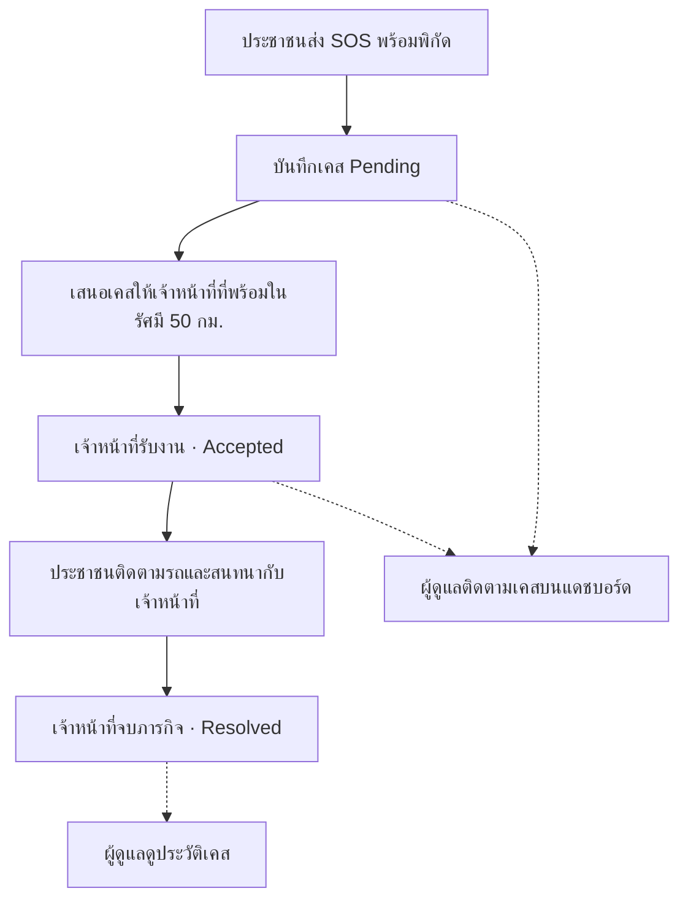

# จากปุ่ม SOS ถึงหน้าศูนย์ประสานงาน

Rescue Connect เป็นโครงงานสาธิตสำหรับห้องเรียน นักศึกษาสามารถเปิดสามหน้าจอพร้อมกันเพื่อดูเหตุเดียวกันจากมุมของผู้แจ้ง เจ้าหน้าที่กู้ภัย และผู้ดูแล แล้วสังเกตว่าแต่ละหน้าจอเปลี่ยนไปอย่างไรเมื่อเจ้าหน้าที่รับงานหรือปิดภารกิจ

## หนึ่งเหตุการณ์ สามหน้าจอ

| ผู้ใช้ | หน้าจอ | สิ่งที่สังเกตระหว่างสาธิต |
| --- | --- | --- |
| ประชาชน | หน้าหลักของเว็บประชาชนผ่าน LINE LIFF | ระบบจำเบอร์ของบัญชี LINE เดิม ผู้แจ้งอนุญาตตำแหน่ง กด SOS ค้าง 5 วินาที แล้วรอดูว่าใครรับงาน |
| เจ้าหน้าที่กู้ภัย | หน้า `/login` ของเว็บประชาชนและเจ้าหน้าที่ | เปิดรับงานเมื่อ GPS พร้อม รับข้อเสนอ ดูจุดเกิดเหตุ สนทนากับผู้แจ้ง และกดจบภารกิจ |
| ผู้ดูแล | หน้า `/login` ของเว็บ Admin | เห็นเหตุที่รอรับและเหตุที่มีผู้รับแล้วบนแดชบอร์ด ตรวจประวัติหลังปิดเคส และจัดการบัญชีเจ้าหน้าที่ |

ลองเปรียบเทียบสองรอบ รอบแรกให้เจ้าหน้าที่เปิดรับงานก่อนแจ้งเหตุ รอบที่สองให้ผู้แจ้งส่ง SOS ขณะที่เจ้าหน้าที่ยังออฟไลน์ เคสจะรอในสถานะ `Pending` เมื่อเจ้าหน้าที่ในพื้นที่กลับมาพร้อมรับงาน ระบบจะลองเสนอเคสอีกครั้ง

## โค้ดส่วนไหนทำอะไร

| ส่วน | หน้าที่ |
| --- | --- |
| [เว็บประชาชนและเจ้าหน้าที่](../rescue-frontend/) | React แสดงฟอร์ม SOS แผนที่ และหน้ารับภารกิจ เบราว์เซอร์ตรวจอายุพิกัดทั้งตอนเริ่มกดค้างและก่อนส่ง |
| [เว็บผู้ดูแล](../rescue-web-admin/) | React แสดงสถานการณ์รวม ประวัติ และหน้าจัดการมูลนิธิและเจ้าหน้าที่ |
| [Backend](../rescue-backend/) | Express รับคำขอ ยืนยันตัวตน และบันทึกการเปลี่ยนสถานะ Socket.IO ส่งข้อเสนองาน ตำแหน่งรถ และข้อความไปยังหน้าจอที่เกี่ยวข้อง |
| [ฐานข้อมูลและบริการในเครื่อง](../rescue-backend/docker-compose.yml) | MySQL เก็บบัญชี เคส และข้อความ ส่วน Redis เก็บพิกัดและสถานะออนไลน์ชั่วคราวเพื่อค้นหาเจ้าหน้าที่ใกล้เหตุ |

## เลือกคู่มือตามงาน

- **ติดตั้งครั้งแรก** เตรียม Node.js, MySQL และ Redis ตั้งค่า LINE ของสถาบัน แล้วสร้างบัญชีทดลอง Admin 1 บัญชีและ Rescue 3 บัญชี [เปิดคู่มือติดตั้ง](HANDOFF-TH.md)
- **สอนหรือดูแลระบบ** ทำตามลำดับแจ้งเหตุ รับงาน ติดตาม และปิดภารกิจ พร้อมวิธีเริ่มเดโมรอบใหม่ สำรองข้อมูล และกู้คืน [เปิดคู่มือสาธิตและดูแล](DEMO-TH.md)
